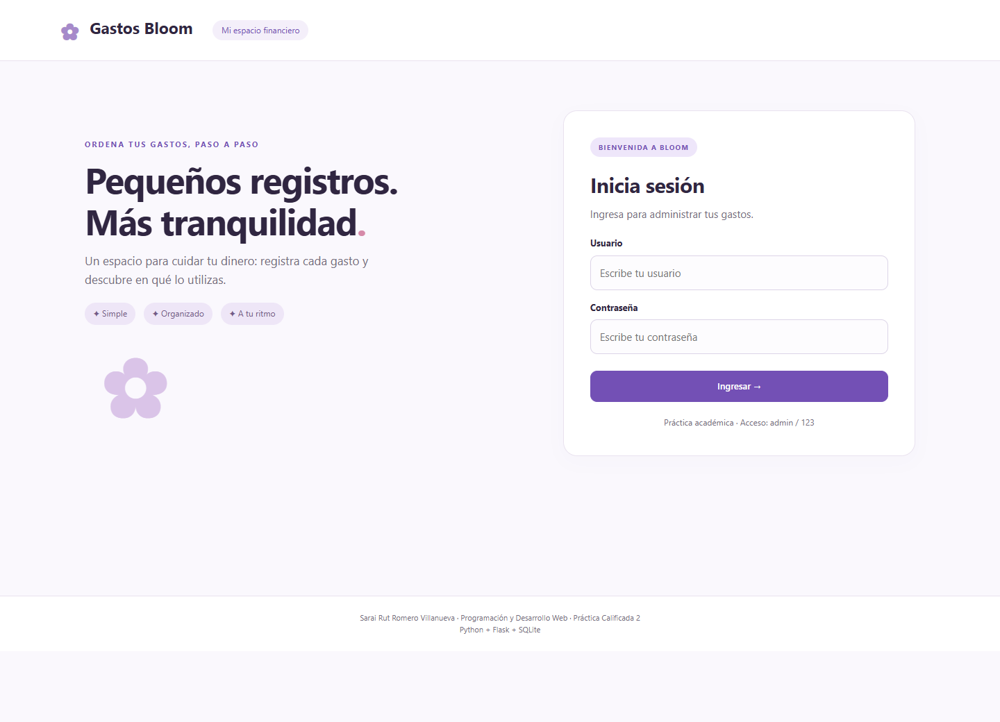
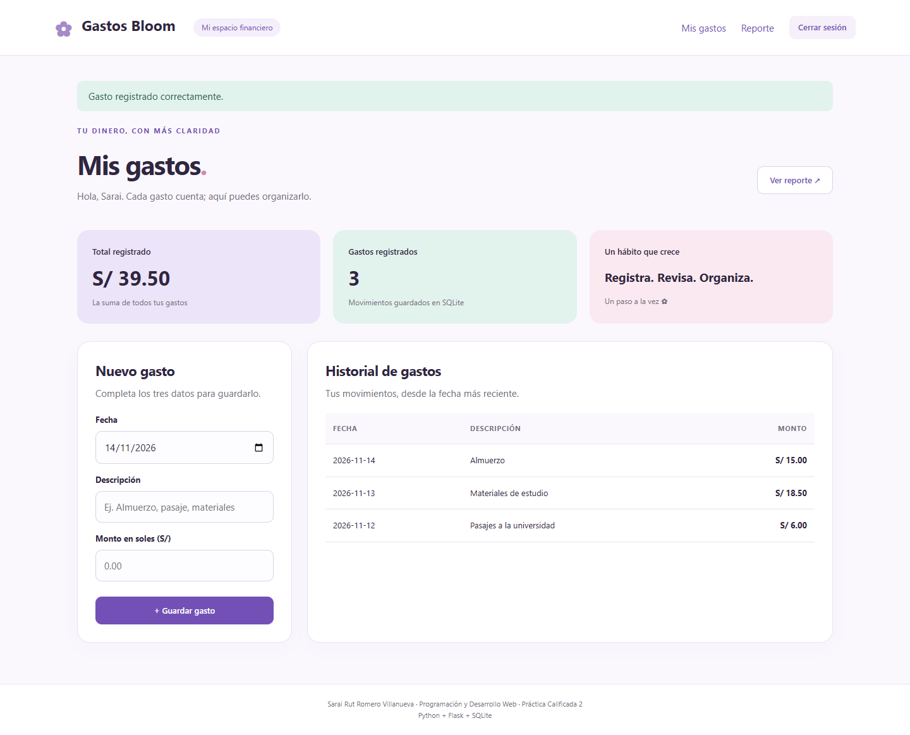
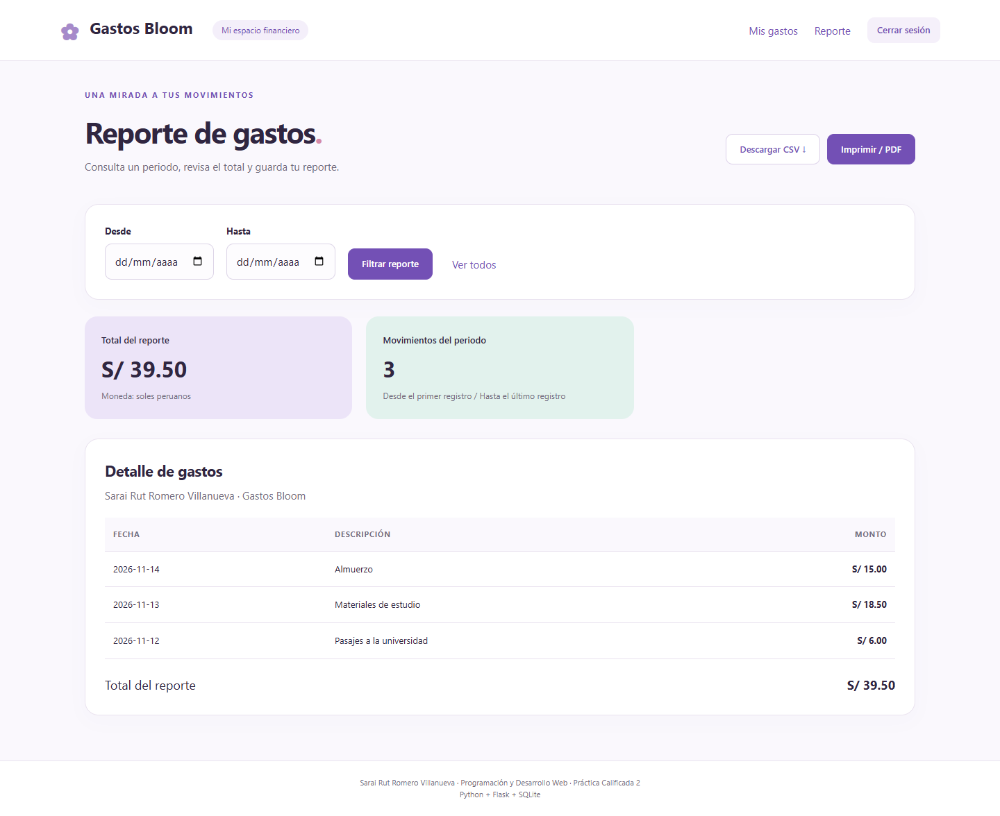
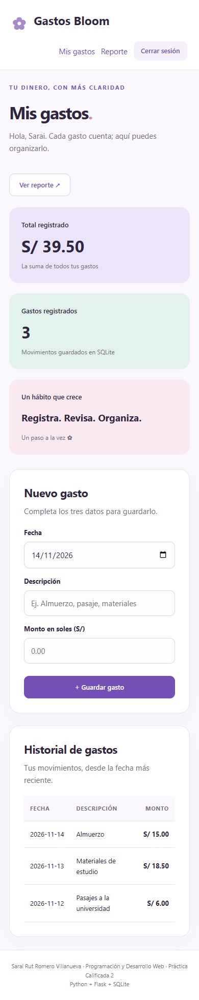

# ✿ Gastos Bloom

Aplicación web para registrar gastos personales y generar reportes, desarrollada con **Python, Flask y SQLite**.

**Estudiante:** Sarai Rut Romero Villanueva  
**Curso:** Programación y Desarrollo Web  
**Evaluación:** Práctica Calificada 2 · 2026-II

## Funciones

- Ingreso con usuario **admin** y contraseña **123**.
- Registro de fecha, descripción y monto en soles.
- Historial con información persistente en SQLite.
- Reporte con filtros por fecha, cantidad de gastos y total.
- Descarga del reporte en CSV e impresión o guardado como PDF desde el navegador.
- Cierre de sesión, validación de formularios y diseño adaptable a celulares.

## Instalación en Windows

Necesitas Python 3.10 o superior instalado. Abre la subcarpeta `gastos-bloom` en Visual Studio Code y selecciona **Terminal > Nueva terminal**. Ejecuta un comando por vez:

```powershell
python -m venv .venv
.\.venv\Scripts\python.exe -m pip install -r requirements.txt
.\.venv\Scripts\python.exe app.py
```

Si Windows no reconoce `python`, utiliza `py -m venv .venv` en el primer comando. No es necesario activar el entorno virtual.

Abre **http://127.0.0.1:5000** en el navegador. Mantén la terminal abierta. Para detener el servidor pulsa **Ctrl+C**.

## Cómo funciona

1. Escribe `admin` y `123` en la pantalla de acceso y pulsa **Ingresar**.
2. En **Nuevo gasto**, selecciona una fecha, escribe una descripción e ingresa un monto positivo con hasta dos decimales.
3. Pulsa **Guardar gasto**. El registro aparece en el historial y actualiza el total.
4. Abre **Ver reporte**. Puedes indicar las fechas Desde y Hasta y pulsar **Filtrar reporte**. Sin fechas se muestran todos los gastos.
5. Pulsa **Descargar CSV** para abrir el reporte en una hoja de cálculo. La descarga respeta el filtro.
6. Pulsa **Imprimir / PDF** y selecciona **Guardar como PDF** en la ventana de impresión.
7. Pulsa **Cerrar sesión** para salir.

La base de datos se crea automáticamente en `instance/gastos.db`. No se borra al cerrar el servidor. Una instalación nueva comienza sin registros. Las capturas incluyen tres gastos ficticios de demostración, por un total de **S/ 39.50**.

## Capturas reales de la aplicación

### Inicio de sesión


### Registro e historial de gastos


### Reporte y total


### Vista en celular


## Estructura

```text
gastos-bloom/
├── app.py                 # Rutas Flask, sesión, validaciones y consultas SQLite
├── requirements.txt       # Dependencia Flask
├── templates/             # Vistas HTML con Jinja2
├── static/style.css       # Estilos de la aplicación
├── capturas/              # Evidencias de funcionamiento
├── tests/test_app.py       # Pruebas automatizadas
├── GUIA_PASO_A_PASO.md     # Guía para Visual Studio Code y GitHub
└── README.md
```

El navegador envía formularios a Flask. Las rutas validan los datos y ejecutan consultas SQL con parámetros. SQLite guarda cada monto como un número entero de céntimos para conservar los importes exactos. Jinja2 presenta los registros en HTML y escapa las descripciones. Las rutas del registro y reporte requieren sesión; los formularios POST incluyen un token CSRF.

## Pruebas

```powershell
.\.venv\Scripts\python.exe -m unittest discover -s tests -v
```

Tres pruebas integradas verifican credenciales, protección de rutas, cierre de sesión, persistencia entre instancias, suma exacta, filtros, CSV, validaciones, protección CSRF y escape de HTML.

## Alcance académico

Las credenciales fijas son las solicitadas por la práctica. El servidor se ejecuta localmente. Publicar el repositorio en GitHub permite compartir el código; GitHub Pages no ejecuta Flask. No es necesario publicar un servidor para entregar el enlace al repositorio público. `.gitignore` excluye el entorno virtual y la base de datos local.

